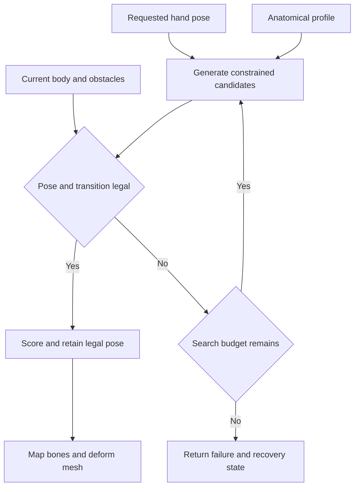

Use this procedure to build an arm solver that respects anatomical movement, remains stable under collision-driven targets, and preserves the mesh during twist.

The implementation has three responsibilities: **define legal joint configurations; find a legal configuration near the requested hand pose; deform the mesh from that accepted configuration.** Reaching the hand target does not override joint limits. A failed search must remain visible as a failed or approximate solve.

The current project hierarchy, bone axes, and solver are unspecified. The names below are semantic roles to map onto the current rig. The Godot appendix uses version 4.6 documentation as a concrete API reference; confirm the installed version before adopting its calls.

# 1 Establish which failure is occurring

An elbow that looks inverted can represent different errors. Diagnose them separately before changing limits.

| Observation | Mechanism to check | Measurement |
| - | - | - |
| Forearm bends past straight in the forbidden direction | Negative signed elbow flexion | Elbow angle relative to the calibrated upper-arm hinge |
| Elbow swings around the shoulder-to-wrist line | A different elbow swivel solution, possibly with excessive shoulder roll | Shoulder swing, shoulder twist, and swivel change |
| Sudden flip near a straight arm or a pole alignment | The bend plane becomes undefined or numerically unstable | Bend angle, elbow-circle radius, projected pole length |
| Hand rotates and drags the elbow frame with it | Forearm roll or hand orientation is being assigned to the wrong control | Transform writer and frame for every rotation |
| Mesh collapses while the bones remain legal | Skinning, twist distribution, or weights | Skeleton-only view compared with a checker-textured mesh |
| Correct pose is overwritten later | Multiple systems write the same transform | Pose snapshots after every animation or modifier stage |

An unsigned angle such as `acos(dot(upper_direction, forearm_direction))` cannot distinguish forward bending from backward bending. Likewise, a positive elbow angle does not prove the shoulder is legal: the entire hinge may have rolled too far.

For the first reproduction, disable mesh rendering, keep the current skeleton visible, freeze the torso, and record a small target sweep through the failure. Preserve both target position and target orientation in the recording.

# 2 Define the anatomical controls

A useful game approximation has seven rotational degrees of freedom below a fixed shoulder socket: three at the shoulder, one for elbow flexion, one for forearm rotation, and two at the wrist. Shoulder-girdle movement adds a moving socket.

| Semantic control | Anatomical action | Runtime representation |
| - | - | - |
| Shoulder girdle | Clavicle and scapula reposition the socket | A constrained socket transform relative to the chest |
| Shoulder swing | Directs the upper arm | Two directional degrees of freedom |
| Shoulder twist | Internal and external humeral rotation | Rotation around the upper-arm shaft |
| Elbow flexion | Bends the forearm relative to the upper arm | One signed hinge angle |
| Forearm rotation | Radius rotates relative to ulna, turning the palm | One bounded axial angle |
| Wrist movement | Flexion, extension, radial and ulnar deviation | Two calibrated bending controls |

These are logical controls, not a requirement to add seven physical bones. A virtual hinge frame and a virtual forearm-roll frame can map onto an existing skeleton.

The shoulder socket is not fixed to the torso in real movement. Bone-pin measurements show coordinated clavicular, scapular, and humeral rotations during arm elevation. Model the socket through a girdle controller or an explicitly limited approximation; do not silently put all overhead movement into the glenohumeral joint. [Shoulder motion study](https://pmc.ncbi.nlm.nih.gov/articles/PMC2657311/)

Forearm pronation and supination involve radius–ulna motion around an approximately longitudinal, somewhat variable axis. A single shaft-axis rotation is a game approximation. It must not redefine the upper arm's elbow hinge. [Forearm axis study](https://pubmed.ncbi.nlm.nih.gov/20483515/)

## Starting limits and their meaning

| Parameter | Initial game setting | Meaning |
| - | - | - |
| Elbow flexion | 0° to 145° | Zero is straight; positive bends toward the calibrated flexion side |
| Elbow free lateral bending | 0° | Any carrying angle belongs to calibrated geometry |
| Forearm pronation | Up to 80° | Measured from a thumb-up reference with the elbow at 90° |
| Forearm supination | Up to 85° | Opposite direction from that same reference |
| Shoulder swing and twist | A calibrated, pose-dependent envelope | No single universal X/Y/Z clamp |
| Wrist flexion and deviation | Character-specific bounded ranges | Preserve existing verified wrist rules when available |

These are initial engineering choices. In a study of 352 adults, mean active flexion was 146°, pronation 80°, and supination 87°; slight elbow hyperextension was also observed. A zero-hyperextension setting deliberately excludes some normal human variation. [Elbow ROM study](https://pmc.ncbi.nlm.nih.gov/articles/PMC6555111/)

Shoulder limits depend on pose and measurement convention. In a young active cohort, mean external rotation was about 76° with the arm at the side and about 99° at 90° abduction; internal rotation at 90° abduction averaged about 55°. These samples illustrate dependency. They are not a complete shoulder limit surface and must not be copied into every shoulder orientation. [Shoulder ROM study](https://pmc.ncbi.nlm.nih.gov/articles/PMC3475119/)

Use radians internally. Convert degrees at the profile/editor boundary.

# 3 Calibrate the anatomical frames

## Name every coordinate space

Use explicit names for world, character or chest, skeleton, imported bone, and anatomical coordinates. Never pass an unnamed vector called `axis` between them.

All equations here use right-handed orthonormal frames, column vectors, and active rotations. In `R_A * R_B`, `R_B` acts first. Matrix columns contain basis vectors. Quaternions below are written as `(w, v)`, with scalar `w` and vector part `v`; check the constructor order of the engine API.

Keep scale out of rotation calculations. Detect negative determinant, nonuniform scale, and shear. Orthonormalizing small numerical drift is reasonable; it does not repair an incorrectly mirrored import. Preserve physical segment lengths independently.

## Build an upper-arm anatomical basis

Use a known, correctly bent calibration pose with shoulder center `S`, elbow center `E`, and wrist center `W`, all in the same coordinate space.

```math
u=\frac{E-S}{\|E-S\|},\qquad
v=\frac{W-E}{\|W-E\|},\qquad
h=\frac{u\times v}{\|u\times v\|}
```

For the ideal hinge model, define:

```math
C_U=[\,h\quad u\quad h\times u\,]
```

- Anatomical **+X** is `h`, the elbow hinge axis.

- Anatomical **+Y** is `u`, the upper-arm shaft toward the elbow.

- Anatomical **+Z** is `h × u`, the initial direction of positive flexion.

The corresponding untwisted forearm basis is `C_F = [h, v, h × v]`. This produces a right-handed frame when the vectors are normalized and perpendicular.

Use the cross product to calibrate from a known legal pose. **Do not regenerate the authoritative hinge from the current potentially illegal pose every frame.** Doing so makes a backward elbow appear positive by flipping the hinge sign along with the error.

A straight chain has no unique bend-plane normal. It therefore requires a separately authored hinge direction or a bent calibration pose. If the asset contains a carrying angle, calibrate a hinge from more than one flexion pose or fit the virtual hinge model; the simple three-point construction assumes zero carrying angle.

## Map anatomical coordinates into imported bone coordinates

For each driven bone, record its imported rotation `R_b0` and desired anatomical basis `C_b0` in the same calibration pose and coordinate space. Store the fixed offset `A_b`:

```math
A_b=R_{b0}^{T}C_{b0}
```

At runtime:

```math
C_b=R_bA_b,\qquad
R_b^{desired}=C_b^{desired}A_b^{T}
```

For a parent with rotation `R_parent` in that same space:

```math
R_{local}^{desired}=R_{parent}^{T}R_b^{desired}
```

These relations use pure rotations. Use full transform inverses when converting points or translated frames.

The calibration pose can differ from the imported bind/rest pose. Record which pose was used and derive the offsets from that exact pose. Never compare a bent anatomical frame against an unrelated rest transform.

Calibrate both sides independently. Keep both anatomical bases right-handed and store an explicit sign converting mathematical forearm rotation into anatomical pronation/supination. Do not mirror a quaternion by negating an arbitrary component.

## Calibrate the shoulder and hand references

The shoulder socket frame is attached to the chest/girdle. Define its neutral +Y as the neutral upper-arm direction and its +X from the calibrated neutral hinge direction. Record the body's forward and upward directions in this frame.

The hand frame needs a palm normal, a finger direction, and a thumb-side reference. Record the rigid transform between that anatomical hand frame and the imported hand bone. A weapon grip marker is a further offset; it is not automatically the wrist joint center.

Before IK, manually apply a small positive rotation to every semantic control. Verify that elbow flexion bends correctly, forearm pronation turns the palm correctly, and the left and right arms agree anatomically.

# 4 Enforce the elbow as a hinge

Use the upper arm's calibrated runtime hinge direction `h`, rather than a world axis or a palm-derived axis.

For normalized shaft directions `u` and `v` in the ideal hinge model:

```math
\alpha=\operatorname{atan2}\!\left(h\cdot(u\times v),\,u\cdot v\right)
```

The allowable interval is `alpha_min ≤ alpha ≤ alpha_max`. A negative angle means the forearm bent across the forbidden side of that calibrated hinge.

Also measure departure from the hinge plane:

```math
\delta_{\mathrm{plane}}=\arcsin\!\left(\operatorname{clamp}(h\cdot v,-1,1)\right)
```

A valid ideal hinge has `delta_plane = 0`. An angle test alone will miss lateral bending.

The strongest implementation is to parameterize the elbow by `alpha` and reconstruct its rotation, rather than accepting arbitrary three-axis rotations and trying to repair them:

```math
R_{\mathrm{elbow}}=R_x(\alpha)
```

Forearm roll is a separate child control:

```math
R_{\mathrm{forearm}}=R_x(\alpha)\,R_y(\rho)
```

Here `rho` twists around the forearm's post-hinge shaft. Because `R_y(rho)` leaves +Y unchanged, changing `rho` does not change the forearm direction or the elbow bend.

This product is the **zero-carrying-angle virtual model**. Imported offsets and a calibrated carrying angle belong in the mapping or in an explicitly defined forward-kinematics model. Do not add a carrying-angle quaternion in an unspecified order.

If one imported forearm bone represents both hinge and roll, write the combined mapped rotation once. A separate wrist pass must not overwrite it with another interpretation.

To inspect existing bone rotations, convert them to the anatomical frame first, fit the legal `Rx(alpha) Ry(rho)` model, and report the residual rotation. Do not obtain the two angles by reading arbitrary imported Euler X and Y values.

# 5 Constrain shoulder swing and twist

Let `q` be the upper-arm anatomical orientation relative to the shoulder socket's neutral frame. Let `a = (0,1,0)` be its reference shaft axis.

Use the factorization `q = q_swing q_twist`. Swing changes the shaft direction; twist changes transverse orientation around the shaft.

For unit `q = (w,v)`:

```math
p=(v\cdot a)a,\qquad
q_{\mathrm{twist}}=\frac{(w,p)}{\sqrt{w^2+\|p\|^2}},\qquad
q_{\mathrm{swing}}=q\,q_{\mathrm{twist}}^{-1}
```

The signed twist is:

```math
\psi=2\operatorname{atan2}(v_{\mathrm{twist}}\cdot a,w_{\mathrm{twist}})
```

This is a standard swing–twist decomposition. It becomes singular when the denominator vanishes, such as a 180° swing about an axis perpendicular to `a`. Detect that case; use a calibrated alternate chart or retained continuous frame, and reject unresolved candidates. Never silently replace the result with identity. [Swing–twist reference](https://arxiv.org/abs/1506.05481)

Maintain quaternion sign continuity: if `dot(q_now,q_previous) < 0`, negate the representation before interpolation. The two signs represent the same physical rotation. Then unwrap scalar twist toward the previous accepted value, while still enforcing the actual anatomical interval. Unwrapping does not authorize a full extra turn.

## Define a directional shoulder envelope

Store:

```text
shoulder_profile:
    reference_socket_frame
    allowed_swing_region
    twist_interval(direction, optional_elbow_flexion, girdle_state)
    preferred_twist(direction)
    softness_near_limits
```

For a candidate, obtain `d = q_swing * a` in socket coordinates. Accept it only when:

```math
d\in\Omega,\qquad
\psi_{\min}(d)\leq\psi\leq\psi_{\max}(d)
```

Here `Omega` is the allowed upper-arm direction region. The bounds must use the same neutral frame and swing–twist convention as the extractor. Clinical rotation angles cannot be pasted into this table without converting their measurement frame.

A practical profile can use a spherical mesh or sampled direction grid. At each sample store a verified twist interval and a preferred posture. Mark uncovered directions invalid. Use conservative interpolation, particularly across boundaries; verify the interpolated poses instead of assuming that valid corner samples make every interior combination valid.

A single round cone with a constant twist interval is a useful debugging approximation. It does not represent the full human shoulder. Pose-dependent limits are a documented improvement over independent joint limits. [Pose-dependent joint-limit research](https://www.cv-foundation.org/openaccess/content_cvpr_2015/html/Akhter_Pose-Conditioned_Joint_Angle_2015_CVPR_paper.html)

## Build the profile

1. Freeze the chest and choose a defined socket/girdle state.

2. Sample arm directions covering the intended gameplay workspace.

3. At each direction, author or measure legal internal and external rotation endpoints in the declared reference frame.

4. Record a preferred interior pose and a margin inside each endpoint.

5. Inspect interpolated poses and collision clearance.

6. Repeat or parameterize for other girdle states when they change the feasible workspace.

Authored samples define the character's movement policy. A claim of validated human range requires suitable anatomical or measured data across that workspace.

Use a soft preference to stay away from extremes, but keep hard bounds. A soft penalty alone can be outweighed by a large target error.

# 6 Solve elbow position without allowing arbitrary swivel

For a fixed shoulder and wrist position, a two-segment arm usually has a **circle of possible elbow positions**. A pole selects a direction on that circle; it does not certify anatomy.

Let `L1` and `L2` be the shoulder-to-elbow and elbow-to-wrist lengths. Let `W_d` be the requested wrist center.

```math
d=\|W_d-S\|,\qquad n=\frac{W_d-S}{d}
```

The ideal hinge relation is:

```math
d^2=L_1^2+L_2^2+2L_1L_2\cos\alpha
```

Therefore the elbow interval implies a radial reach interval:

```math
d_{\min}=\sqrt{L_1^2+L_2^2+2L_1L_2\cos\alpha_{\max}}
```

```math
d_{\max}=\sqrt{L_1^2+L_2^2+2L_1L_2\cos\alpha_{\min}}
```

These bounds assume `0 ≤ alpha_min ≤ alpha_max ≤ pi` and the ideal hinge geometry. They are necessary, not sufficient: shoulder limits and collisions may remove much of that radial shell. A nonzero carrying-angle model requires reach bounds derived from its own forward kinematics.

Clamp or reject a distance outside the shell according to gameplay policy. Report the difference between the original requested target and the adjusted target. For `d` near zero, do not divide by it; choose an explicitly defined fallback direction or return a degenerate-target result.

For a reachable distance:

```math
c=\frac{L_1^2-L_2^2+d^2}{2d},\qquad
r=\sqrt{\max(0,L_1^2-c^2)}
```

Choose perpendicular unit vectors `b1` and `b2 = n × b1`. Candidate elbow positions are:

```math
E(\phi)=S+cn+r\left(b_1\cos\phi+b_2\sin\phi\right)
```

For each candidate:

1. Reconstruct `u` and `v` from its joint positions.

2. For a non-straight ideal hinge, construct the required positive-flexion frame using `h = normalize(u × v)`.

3. Convert that upper-arm frame into socket coordinates.

4. Check shoulder swing and twist limits.

5. Solve the remaining bounded forearm and wrist orientation controls.

6. Check the complete pose and transition for collisions.

7. Score only surviving candidates.

Here the candidate cross product constructs a proposed legal hinge orientation; the shoulder limit then decides whether that orientation is allowed. This differs from changing the hinge sign while inspecting an existing invalid pose.

**Elbow swivel and shoulder roll are coupled.** Once the elbow and wrist positions define a bent arm plane, the upper arm's hinge orientation is largely determined. Clamping shoulder twist after choosing the elbow generally destroys that solution. Reject or re-solve the candidate instead.

For a reference implementation, sample swivel deterministically, refine around legal candidates, and include the transported previous solution. Fixed coarse sampling can miss narrow feasible regions; its failure means “no solution found within this search,” not proof of geometric impossibility.

## Handle straight-arm and pole singularities

As `alpha → 0`, `r → 0`: many swivel values become the same joint position, while their orientations can still differ. Small numerical changes can therefore cause a large apparent roll.

Project the preferred bend direction `p` away from the reach axis:

```math
p_\perp=p-n(n\cdot p)
```

If `p_perp` is too short, keep a transported previous bend reference or use an authored chest-relative fallback. Do not normalize a near-zero vector.

Transport the previous frame with the change in reach direction, then reproject. Handle an approximately antiparallel direction change explicitly because its shortest-arc rotation axis is also ambiguous.

Keep exact extension available if gameplay needs it; treat its orientation as a separate continuity case. Alternatively, an engineering margin such as a 5° minimum bend can keep the interactive solver away from the singularity. For equal segment lengths this changes maximum reach to `cos(2.5°) ≈ 0.99905` of full reach. A large arbitrary reach reduction can remove much more motion than intended.

Store continuity information in a declared chest or solve frame. A previous world-space elbow must not remain behind when the character turns.

# 7 Solve the hand orientation within the remaining freedom

A target is a full pose: position plus orientation. Validate both.

If the requested target belongs to a grip marker rather than the hand origin, convert it first. With `T_HG` mapping the grip frame into hand coordinates:

```math
T_{WH}^{desired}=T_{WG}^{desired}\,(T_{HG})^{-1}
```

The translation of the resulting transform is the requested hand origin. If that origin differs from the wrist center, apply the additional calibrated offset. Changing grip orientation can change the required wrist position; do not keep using a wrist position computed from a different orientation.

For a fixed legal shoulder/elbow candidate, solve forearm rotation `rho` and wrist angles `beta, gamma` within their limits. One explicit virtual model is:

```math
C_H=C_U R_x(\alpha)R_y(\rho)R_{FH0}R_x(\beta)R_z(\gamma)
```

`R_FH0` aligns the untwisted forearm and neutral hand frames. The hand +X axis is the calibrated flexion axis and +Z is the calibrated deviation axis. The chosen wrist rotation order is part of the model; swapping it changes the pose.

Fit the remaining orientation with a bounded numerical solve or a deterministic search and refinement. Minimize the rotation error between the produced and requested hand frames. Do not extract one arbitrary Euler component from the target and call it forearm pronation.

A quaternion angle error can be measured with:

```math
e_R=2\arccos\!\left(\operatorname{clamp}(|q_{desired}\cdot q_{actual}|,0,1)\right)
```

For optimization, use a consistent three-component rotation-vector residual instead of only this scalar magnitude. Express the residual and its Jacobian in the same frame. Near a 180° error, define a deterministic branch or smaller continuation steps.

If orientation cannot be reached, revisit elbow swivel or the shoulder-girdle state. Otherwise retain a legal approximate pose and return the orientation error.

For a two-handed rigid object, both hands must use grip transforms from the same accepted object pose. If either arm cannot reach its grip legally, the controller needs an explicit policy: adjust the object, relax a grip, or stop the requested motion. Two independent solvers must not secretly assign incompatible poses to the same object.

# 8 Integrate anatomical constraints into the solve

Define the joint state in semantic parameters. For the ideal fixed-socket arm, use shoulder swing/twist, elbow flexion, forearm rotation, and wrist flexion/deviation. Add girdle parameters only when that subsystem is enabled.

The feasible set contains:

- The shoulder envelope and all scalar joint bounds.

- Fixed segment lengths and calibrated offsets.

- Forearm and wrist restrictions.

- Body, limb, object, and environment clearance required by the gameplay model.

- Any hard per-step motion restrictions that the controller actually promises.

Hand position, hand orientation, preferred elbow placement, continuity, and distance from joint limits are objectives within that feasible set.

A representative objective is:

```math
J(\theta)=
w_p\frac{\|p(\theta)-p_d\|^2}{L^2}
+w_R\|\log(R_d R(\theta)^T)\|^2
+w_c\|\Delta\theta_{\mathrm{previous}}\|^2
+w_r\|\Delta\theta_{\mathrm{preferred}}\|^2
```

`L` is a reference length such as full arm length. The logarithm here returns a three-component rotation vector in radians. Use geodesic or wrapped differences for rotational parameters, not naive subtraction across angle-wrap boundaries. Weights are gameplay priorities, not anatomical measurements.

Keep forbidden poses out of the candidate set. A finite “joint violation penalty” can always lose to a sufficiently large target error.

## Reference solver structure

```text
solve_arm(request, body_state, profile, previous_state):
    validate_profile_and_coordinate_spaces()

    desired_hand = resolve_target_and_grip_offsets(request)
    seeds = generate_legal_or_projectable_seeds(
        previous_state, preferred_pose, body_state
    )
    best = NONE

    for girdle_candidate in bounded_girdle_candidates(seeds):
        socket = evaluate_socket(girdle_candidate, body_state)

        for target_candidate in candidate_wrist_targets(desired_hand):
            # Radial reach is a broad filter, not the complete legality test.
            reach = analyze_reach(socket, target_candidate, profile)
            if reach.degenerate:
                handle_degenerate_case_or_continue()

            for swivel in ordered_swivel_candidates(reach, previous_state):
                state = reconstruct_hinge_arm(reach, swivel)
                if not shoulder_and_elbow_legal(state):
                    continue

                state = fit_bounded_forearm_and_wrist(state, desired_hand)
                if not all_joint_rules_hold(state):
                    continue
                if not final_pose_clear(state, body_state):
                    continue
                if not transition_clear(previous_state, state, body_state):
                    continue
                if not hard_motion_limits_hold(previous_state, state):
                    continue

                best = choose_lower_cost(best, state, original_request)

    if best exists:
        return accepted_pose_with_residuals(best)

    return explicit_failure_and_revalidated_fallback()
```

`candidate_wrist_targets` must include the original target when reachable. If adjustment is allowed, it explores or optimizes feasible alternatives near that target, including the policy-defined fallback. Evaluating only one radially clamped point can fail even when a nearby legal pose exists.

The pseudocode defines responsibilities, not a claim that a fixed sample count finds every solution. A local optimizer can also fail in a nonconvex workspace. Distinguish `NO_SOLUTION_FOUND` from a proven reach impossibility.

Numerical IK commonly uses a previous solution as an initial guess for a nearby target. That helps continuity but does not replace constraint checks. [Numerical IK reference](https://modernrobotics.northwestern.edu/nu-gm-book-resource/6-2-numerical-inverse-kinematics-part-1-of-2/)

## A bounded numerical alternative

If replacing the existing solver is undesirable, optimize the semantic joint parameters using damped steps. After each proposed step, enforce scalar bounds, shoulder-envelope membership, and collision feasibility; recompute forward kinematics before accepting progress.

A typical damped task-space step has the form:

```math
\Delta\theta=J^T(JJ^T+\lambda^2I)^{-1}e
```

Here `J` is the task Jacobian, `e` is the desired-minus-current task residual, and `lambda > 0` is the damping parameter. Keep the Jacobian sign convention consistent with that residual. Use a linear solve, not an explicit matrix inverse. Scale position and orientation residuals consistently; bound the step and use line search or a trust region. Joint or collision constraints require an active-set, constrained optimization, or validated projection strategy around this step. Damping alone does not enforce them.

Alternating a free IK pass with a final clamp can oscillate, lose contact, or cross a collision. If projection is used, it belongs inside the iterative search, followed by forward kinematics and a fresh acceptance test.

# 9 Make collisions and continuity part of legality

Represent the upper arm and forearm with capsules or other appropriate volumes. Include the elbow, hand, held object, torso, and relevant environment. Ignore intended adjacent-body overlap through explicit collision-pair rules rather than removing all self-collision.

A collision-free wrist point does not imply a collision-free arm. Likewise, two collision-free endpoint poses do not imply a collision-free transition.

A useful signed-distance condition is:

```math
g_k(\theta)\geq m_k
```

`g_k` is the clearance for a required pair and `m_k` is its selected margin. When exact signed distance is unavailable, use conservative shape tests with a documented clearance policy.

Check the motion path with sweeps or conservative subdivision. For rotating limbs, a single translational capsule cast may miss the arc swept by the limb. Collision samples must use the interpolated articulated pose, or a conservative bound of that swept volume.

Keep preferred targets, collision-adjusted target candidates, and the final accepted pose separate. Log their differences. The collision module may propose alternatives; it must not write an arbitrary joint rotation afterward.

Continuity is also constrained:

- Prefer candidates near the previous accepted joint state.

- Use hysteresis before changing between equally good swivel solutions.

- Limit speed through joint-parameter steps or within the solve.

- Revalidate any interpolated pose. Interpolation between legal configurations can cross an obstacle or a nonconvex shoulder boundary.

- Use an explicit reset/reseed policy for teleports and target discontinuities.

Do not apply a cosmetic smoothing pass after all checks and assume the result remains legal.

The previous pose is only a fallback after evaluation against the current torso and environment. A moving obstacle or teleported body can invalidate it. Return a recovery state to the gameplay controller when no currently legal fallback exists.

A useful result contract is:

```text
ArmSolveResult:
    status:
        EXACT
        APPROXIMATE
        REACH_IMPOSSIBLE
        NO_SOLUTION_FOUND
        INVALID_PROFILE
        DEGENERATE_TARGET
        RECOVERY_REQUIRED
    accepted_joint_state
    requested_hand_transform
    achieved_hand_transform
    position_error_m
    orientation_error_rad
    active_joint_limits
    minimum_checked_clearance_m
    used_continuity_fallback
    search_iterations
```

`EXACT` means within declared numerical tolerances. It does not mean mathematically zero error.

The control relationship should be:



# 10 Distribute twist without changing the accepted pose

Joint constraints and mesh deformation solve different problems. Linear blend skinning averages transformed vertex positions. Blending rotation matrices can produce scale or shear, which explains collapse during twist. Dual quaternion skinning addresses this class of artifact, though it is not a universal replacement for good weights and corrective deformation. [Skinning research](https://users.cs.utah.edu/~ladislav/kavan07skinning/kavan07skinning.pdf)

A simple illustration: blend a cross-section equally between 0° and 180° rotation around its centerline. Their transverse components cancel at the midpoint of the blend. Both bone rotations are valid rotations; their linear average is not.

## Separate kinematic and deformation roles

The kinematic arm determines joint centers and the accepted hand orientation. Twist helpers distribute its rotation over the surface. Give helpers suitable vertex weights; an unweighted twist bone cannot improve the mesh.

For cumulative forearm roll `rho`, define a distribution `f(s)` along normalized forearm distance `s`:

```math
\rho(s)=f(s)\rho,\qquad f(0)=0,\quad f(1)=1
```

This is a deformation profile, not an anatomical measurement. Its shape depends on the mesh and weight layout.

For a serial chain with cumulative target fractions 0, 0.25, 0.60, and 1.00:

| Location | Desired cumulative roll | Increment relative to preceding helper |
| - | - | - |
| Proximal reference | 0 | 0 |
| Helper A | 0.25 rho | 0.25 rho |
| Helper B | 0.60 rho | 0.35 rho |
| Distal end | 1.00 rho | 0.40 rho |

These scalar increments assume aligned shaft axes and compatible bind orientations. For a general hierarchy, construct each desired cumulative orientation in one declared frame, then derive its parent-relative transform. Do not assign cumulative fractions as local increments; that double-counts twist.

For sibling helpers, each helper usually receives its own cumulative target relative to a shared reference. The serial-chain difference rule does not apply.

If a helper is an ancestor of the hand, compensate downstream transforms so that the accepted wrist center and hand orientation remain unchanged. If helpers are off-axis, their rotation can move descendants; check their geometry rather than assuming twist preserves positions.

Apply the same distinction to upper-arm helpers: distribute the already accepted humeral twist without changing the elbow's kinematic hinge frame.

## Deformation acceptance checks

1. Turn the forearm through its legal range while keeping elbow flexion fixed.

2. Verify that the elbow position and hinge direction remain unchanged by forearm roll.

3. Verify the final hand transform before and after helper distribution.

4. Inspect cross-section volume, texture shear, elbow folds, and wrist seams.

5. Check normalized skin weights and the influence count supported by the renderer.

6. Test combined flexion and twist, not only either movement alone.

Where the existing skinning method still collapses, adjust helper layout, weights, and corrective shapes, or evaluate another supported skinning method. Hiding the collapse by blocking all legitimate shoulder or forearm roll changes the movement model rather than fixing deformation.

# 11 Give modules explicit ownership

Use these as interface roles; map them onto existing project systems rather than assuming these files already exist.

| Module role | Reads | Produces | Invariant |
| - | - | - | - |
| Rig adapter | Current skeleton and calibration | Joint frames, lengths, imported-bone mappings | All conversions have declared spaces |
| Anatomy profile | Character parameters | Joint bounds and shoulder envelope | Missing calibration is an error |
| Target resolver | Gameplay target and grip offsets | Requested hand/wrist transform | Position and orientation describe the same target |
| Collision interface | Current scene and candidate poses | Clearance and transition results | Does not modify the skeleton |
| Arm solver | Targets, anatomy, collision results, previous state | Accepted semantic joint state and residuals | Hard constraints hold for accepted poses |
| Bone writer | Accepted state and adapter | One coherent skeleton pose | No independent late override |
| Deformation pass | Accepted rotations and mesh profile | Twist-helper and corrective transforms | Accepted kinematic anchors stay fixed |
| Diagnostics | Every stage | Traces and visible axes | Distinguishes request, candidate, and accepted state |

A compact profile schema is:

```text
ArmProfile:
    side
    profile_version
    skeleton_signature
    semantic_bone_mapping
    anatomical_offsets_by_bone
    socket_reference_transform
    hand_and_grip_offsets
    upper_arm_length_m
    forearm_length_m
    carrying_angle_model
    elbow_flexion_interval_rad
    forearm_pronation_limit_rad
    forearm_supination_limit_rad
    forearm_rotation_sign
    shoulder_envelope
    wrist_model_and_limits
    preferred_pose
    collision_shapes_and_pair_rules
    solver_tolerances
    twist_helper_hierarchy_and_distribution
```

Invalidate or recheck calibration when bone rests, proportions, hierarchy, or mirroring change. Recompute lengths when a modular body changes proportions. A world-scale change also changes collision and distance tolerances; a rotation-only normalization does not handle it.

Store the raw requested motion independently of the accepted pose. Otherwise each frame may feed the previous correction back into the request and drift away from the actual gameplay intent.

# 12 Integrate with Godot through a narrow adapter

The following references are explicitly for **Godot 4.6**. They illustrate integration points; they do not identify the current project's version or architecture.

`Skeleton3D.get_bone_global_pose()` returns a pose relative to the skeleton, not the scene's world space. Convert it using the skeleton's world transform:

```text
T_world_bone = T_world_skeleton * T_skeleton_bone
T_skeleton_desired = inverse(T_world_skeleton) * T_world_desired
T_parent_local = inverse(T_skeleton_parent) * T_skeleton_desired
```

For a root bone, use the skeleton-space identity as the parent transform. Apply the anatomical mapping before writing imported-bone rotations. Godot's local pose rotation is relative to parent bones; its rest transform defines the initial pose. Confirm the adapter with a rest-pose round trip and do not multiply rest rotation into a full desired local rotation a second time. [Skeleton3D reference](https://docs.godotengine.org/en/4.6/classes/class_skeleton3d.html)

`SkeletonModifier3D` is the integration point for custom constraints and IK; modifications run after `AnimationMixer` playback. Select one callback domain and establish explicit writer order. Read a modifier's result at its `modification_processed` signal, or the completed modifier stack at `Skeleton3D.skeleton_updated`, rather than sampling an earlier pose and diagnosing it as final. [SkeletonModifier3D reference](https://docs.godotengine.org/en/4.6/classes/class_skeletonmodifier3d.html)

`TwoBoneIK3D` uses a pole to determine the arm plane. Its documentation warns against collinear pole and forward directions. Intermediate bones between the configured joints are treated through virtual straight segments and their rotations are ignored by that solve. A pole configuration therefore does not supply the complete anatomical model or guarantee that twist helpers are handled. [TwoBoneIK3D reference](https://docs.godotengine.org/en/4.6/classes/class_twoboneik3d.html)

`IterateIK3D` exposes joint rotation axes and limitation resources; `JointLimitation3D` belongs to the chain-IK limitation system. Treat those facilities as building blocks and verify whether their available constraints express the required signed hinge and pose-dependent shoulder envelope. Do not assume a generic cone resource enforces forearm twist or hand orientation. [IterateIK3D reference](https://docs.godotengine.org/en/4.6/classes/class_iterateik3d.html)

`BoneTwistDisperser3D` distributes child twist toward parent bones without changing joint positions. Its documentation warns of flipping when extracted twist exceeds 180°. Use a calibrated reference and bounded anatomical twist, and confirm final hand orientation and deformation across the whole allowed workspace. [BoneTwistDisperser3D reference](https://docs.godotengine.org/en/4.6/classes/class_bonetwistdisperser3d.html)

An engine physics joint limit is not automatically an IK bone constraint. If the arm is not being posed by the corresponding physical-body solver, adding physics joint settings alone will not restrict an independent kinematic pose writer.

# 13 Implement in stages and verify each stage

## Stage A Make the current rig observable

Draw the chest/socket frame, upper-arm shaft, authoritative hinge axis, forearm shaft, requested wrist pose, achieved wrist pose, and elbow-circle/pole reference.

Log:

```text
frame and update phase
writer/module name
left/right side
requested and achieved hand transforms
shoulder swing direction
shoulder twist and its current allowed interval
signed elbow flexion
elbow plane error
forearm rotation
wrist parameters and fitting residual
projected pole length and elbow-circle radius
collision clearance and checked path result
solve status and target residuals
```

Record before and after each stage. This locates whether the first illegal value appears in target generation, solving, bone mapping, hand alignment, or deformation.

## Stage B Prove calibration and the hinge

With collision response and hand-orientation fitting disabled, drive elbow flexion directly through the configured interval. Both arms must bend correctly. Inject a negative angle and confirm rejection or clamping according to the chosen interface contract.

Rotate the whole character through several world orientations. The same anatomical pose must produce the same joint parameters. A changed result reveals a space-conversion error.

## Stage C Add bounded forearm and wrist orientation

Hold shoulder and elbow fixed. Sweep pronation/supination. The hand may turn; elbow position and hinge frame must remain unchanged. Verify both signs on both sides.

Then enable wrist controls and fit achievable and unachievable target orientations. Unachievable requests must produce a residual or failure, not an elbow or shoulder limit violation.

## Stage D Add shoulder envelope and stable swivel

Run targets forward, sideways, across the body, behind the body, and overhead within the chosen profile. Check the upper-arm orientation against the socket-relative envelope.

Sweep slowly through full extension or the configured minimum-bend boundary. Move the pole reference toward collinearity with the reach axis. No arbitrary 180° frame change is acceptable.

## Stage E Add collision handling and movement of the torso

Test obstacles at the hand, elbow, and mid-forearm. Include a case where the hand is clear but the arm intersects the torso. Include a transition whose endpoint poses are clear but whose path crosses an obstacle.

Move and rotate the torso while targets remain fixed in the world, then test targets attached to the torso. Confirm the selected target frame rather than letting it change implicitly.

## Stage F Enable deformation and modular variants

Enable twist distribution and compare kinematic anchors before and after it. Test long and short arm variants, altered proportions, both sides, and every module that changes rest transforms or bind weights.

Finally re-enable the full animation/modifier stack. Check that no later writer invalidates the accepted pose.

## Acceptance criteria

Choose numerical tolerances from the character scale and gameplay requirements. Useful initial development tolerances are **0.1°** for a constructed hinge's plane/limit checks and **1 mm** for transform round-trip checks on a roughly human-sized rig. These are engineering test thresholds, not anatomical allowances or collision margins.

| Test | Pass condition |
| - | - |
| Frame round trip | Anatomical-to-bone-to-anatomical conversion stays within tolerance |
| Hinge sweep | Signed flexion stays inside bounds; no unexplained lateral component |
| Negative-flexion injection | Forbidden bend cannot be accepted |
| Forearm-only rotation | Elbow position and hinge frame remain fixed |
| Shoulder boundary | Accepted swing and twist remain in the same profile envelope |
| World rotation invariance | Joint readings are unchanged by rigidly rotating the complete setup |
| Extension and pole alignment | Finite output and continuous chosen frame, or explicit controlled failure |
| Impossible target | Measured residual or failure; no stretched bones or illegal angles |
| Collision path | Accepted endpoints and evaluated transition satisfy the collision policy |
| Twist helpers | Accepted wrist position and hand orientation remain fixed |
| Multiple writers | Final rendered skeleton still satisfies the accepted state |
| Modular change | Stale calibration is rejected or recomputed |

A visually plausible single pose is not a pass. Use recorded sweeps and repeatable parameter tests.

# 14 Implementation handoff

Build an anatomical constraint layer around the current arm solver with the following deliverables:

1. **Audit:** identify the actual arm chain, imported rest axes, twist helpers, grip offsets, update phases, and every bone writer.

2. **Calibration:** produce a versioned profile for each arm with anatomical offsets, hinge sign, forearm sign, neutral hand frame, and measured segment lengths.

3. **Joint model:** implement a signed elbow hinge, separate bounded forearm roll, calibrated wrist movement, and a socket-relative shoulder envelope.

4. **Solver integration:** enforce these rules during candidate generation or iteration; return explicit residuals and failure status.

5. **Collision integration:** test the arm and its transition, not only the hand target; keep target correction from overriding joint limits.

6. **Deformation:** distribute accepted twist through the actual helper hierarchy and weights while preserving kinematic anchors.

7. **Verification:** run the stage tests, retain failing target recordings, and report the first stage that introduces an illegal rotation.

Keep the implementation's solver choice separate from the invariants. An existing analytic solver, iterative solver, or custom modifier can be retained if it can satisfy the same checks.

The core acceptance rule is: **a requested hand pose may be approximated or rejected; an anatomically forbidden joint pose must not become an accepted solution.**

# Sources and scope

| Source | Supports |
| - | - |
| [Zwerus et al. Elbow range of motion](https://pmc.ncbi.nlm.nih.gov/articles/PMC6555111/) | Measured elbow and forearm ROM, variation, and measurement posture |
| [Ludewig et al. Shoulder complex motion](https://pmc.ncbi.nlm.nih.gov/articles/PMC2657311/) | Coordinated clavicle, scapula, and humerus movement |
| [Clinical shoulder ROM cohort](https://pmc.ncbi.nlm.nih.gov/articles/PMC3475119/) | Shoulder rotation values tied to specified test poses |
| [In vivo forearm axis analysis](https://pubmed.ncbi.nlm.nih.gov/20483515/) | Radius–ulna rotation and axis behavior |
| [Akhter and Black. Pose-conditioned joint limits](https://www.cv-foundation.org/openaccess/content_cvpr_2015/html/Akhter_Pose-Conditioned_Joint_Angle_2015_CVPR_paper.html) | Why pose-independent limits can admit invalid configurations |
| [Dobrowolski. Swing–twist decomposition](https://arxiv.org/abs/1506.05481) | Rotation decomposition background |
| [Lynch and Park. Numerical inverse kinematics](https://modernrobotics.northwestern.edu/nu-gm-book-resource/6-2-numerical-inverse-kinematics-part-1-of-2/) | Iterative IK and use of previous solutions |
| [Kavan et al. Skinning with dual quaternions](https://users.cs.utah.edu/~ladislav/kavan07skinning/kavan07skinning.pdf) | Linear blend skinning collapse and alternative blending |
| Godot references linked in section 12 | Version-specific API behavior |

The virtual joint model, suggested module interfaces, search structure, tolerances, and deformation fractions are engineering designs for implementation. They are not a measured full-body biomechanical model or a diagnosis of the current project.
