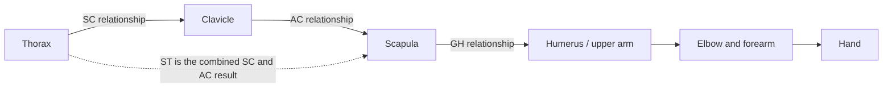

# Shoulder Anatomy and Unarmed Rig Reference — 2026-10-28

Start here for the next shoulder/arm investigation. **This pass saves research and code mapping only. No anatomical correction was implemented or tested in this pass.** The user selected Skill Crafter **Unarmed** as the first future test surface, to examine the shared body without weapon acquisition obscuring the result. This does not revive the separately deferred manual shoulder-control feature.

## Latest user decisions, 2026-10-28

For the consolidated guide review and complete current scope, read [Arm Rig Guide Review and Shared Body Scope](<../Reserch/Arm Rig Guide Review and Shared Body Scope 2026-10-28.md>). The bullets below are its concise decision summary.

- **Goal: usable, predictable Skill Crafter body manipulation.** The user explicitly withdrew the triangular-return example as an acceptance target. Do not force exact closed-loop orientation restoration or an absolute-reference solver on that basis. Continuity/history are implementation choices to judge by usable behavior, not compliance with that example.
- **Shared body implementation.** The intended correction belongs to the common body system used with no weapon and with every current/future weapon archetype. Unarmed is the existing test setup used to remove weapon/grip effects while examining the body. Do not implement an Unarmed-only correction. Later attachment and armed integration checks still verify consumers of that same body rule.
- **Conditional tolerance, up to 3%.** Follow the paper/guide as guidance; add a tolerance only if needed. The user's follow-up was: “use the paper as guidance, if need be we can implement tolerance on top of that, if need be.” This is not an automatic 3% expansion of all joint ranges or a requirement to use the whole allowance.
- For every adopted tolerance, document what is being measured, whether it accepts target error or adds a joint-bound margin, its nonzero reference magnitude, and its resolved physical value. A percentage of a world coordinate or of an angle that happens to be zero is not a usable normalization. Candidate references such as relevant segment length/reach or an angular interval need to be selected for the specific check. No denominators or revised live thresholds were selected in this documentation pass.
- **Implementation remains on hold during comparison.** The user-provided [Arm Rig Constraints and IK Implementation Guide](<../Reserch/The Will Arm Rig Constraints and IK Implementation Guide.md>) is an additional design reference, not a replacement authority. Its illustrative numerical defaults are not automatically adopted.

## Reading order and evidence

1. [Anatomy research and bibliography](<Shoulder Anatomy Research 2026-10-28.md>): original papers, measured movement, coordinate conventions, limitations, and source-access record.
2. This document: working coordinate explanation, comparison of findings, and a bounded validation plan.
3. [Live rig mapping audit](<Shoulder Rig Mapping Audit 2026-10-28.md>): actual bones, rotation writers, current numerical allowances, Unarmed entrypoints and capture/replay dependencies. Includes the inspected working-tree fingerprints.
4. [Body mobility task](<Skill Crafter Body Mobility Preparation 2026-10-19.md>): earlier implementation evidence and remaining faults. Earlier successful checks do not certify the full anatomical chain.

The papers establish useful constraints on interpretation; they do not identify our bug without a fresh rig test. The user-visible symptom is elbow inversion and twisted skin. Shoulder-frame ownership, elbow-plane ownership, skin-helper distribution and rejected-edit restoration remain distinguishable candidate causes.

## 1. What moves relative to what

This is a conceptual relationship diagram, not a proposed Godot bone hierarchy:



The [anatomy companion](<Shoulder Anatomy Research 2026-10-28.md#shoulder-movement-is-a-coupled-chain>) explains the biological movements and supporting studies. In our asset, there is no separately named scapula bone. The existing Clavicle is a reduced support link; equating it directly to the entire biological shoulder would conceal an approximation.

Useful vocabulary for our investigation:

| Term | Meaning in the investigation |
| --- | --- |
| Translation along an axis | A point moves without that fact alone specifying rotation. Record distance and coordinate frame. |
| Swing / elevation direction | The upper-arm shaft changes its pointing direction. Its two endpoints do not uniquely determine its axial orientation. |
| Humeral axial orientation | Which way the upper-arm frame faces around its shaft, relative to a stated support frame and neutral. |
| Elbow orbit control | The elbow moves around the shoulder-to-hand axis while the hand target is held. This is what our manual “upperarm roll” control primarily requests; it is not simply rotation around the humeral shaft. |
| Forearm pronation/supination | A separate anatomical relationship involving radius and ulna. Do not label every palm-facing change as isolated wrist rotation. |
| Skin twist helper | A rig deformation mechanism. A helper branching beside the Forearm cannot, by parent inheritance, define the Forearm's hinge frame. |
| Surface rolling | Contact-surface motion; different from a bone's axial orientation. The current investigation does not require an articular contact simulation. |

Forearm evidence reinforces this distinction: an in-vivo CT study of five volunteers modeled radius motion relative to ulna and found a variable rotation axis. It does not supply a fixed wrist-roll clamp. [Tay et al., 2010, primary abstract](https://pubmed.ncbi.nlm.nih.gov/20483515/)

## 2. Coordinate worksheet

### Published convention to preserve

Use **Wu et al. 2005**, not an unnamed mixture of ISB editions. Thorax directions are X forward, Y upward, Z right. Humeral +Y points proximally toward the shoulder. GH reporting uses intrinsic Y–X′–Y″: elevation plane, elevation, axial orientation. SC/AC/ST use Y–X′–Z″; elbow uses Z–X′–Y″. These are reporting conventions, not three unrestricted motor axes or allowed-angle tables. Right-side definitions require an explicit left-side mapping. [Wu et al., sections 2.3–3.4, official searchable PDF](https://media.isbweb.org/images/documents/standards/Wu%20et%20al%20J%20Biomech%2038%20%282005%29%20981%E2%80%93992.pdf)

The older [Van der Helm protocol](https://media.isbweb.org/images/documents/standards/frans_c.t._van_der_helm_shoulder_protocol.pdf) uses a different global axis assignment. Never combine its axis letters with the 2005 rotation sequences without conversion.

### Engineering notation for this project

The following is our explanatory notation, not copied implementation code:

- `R_AB` maps a vector expressed in frame B into frame A. Use column vectors and compose rightmost first.
- `T`, `C`, `S`, `H` mean thorax, clavicle, scapula and humerus.
- `R_TH = R_TC * R_CS * R_SH`. The shoulder-girdle contribution is already included; do not also multiply an independent ST contribution into this chain.
- Position requires a transform origin as well as a rotation. These rotation equations alone do not move a joint centre.
- Quaternion/basis storage describes the full orientation. Euler coordinates are a chosen report of that orientation, not the physical object itself.

Calibration must map the imported skeleton to these frames. If `C_parent` maps anatomical-parent coordinates into imported-parent coordinates, and `C_child` does the corresponding child conversion, then:

```text
R_anatomical_parent_child = inverse(C_parent) * R_imported_parent_child * C_child
```

For orthonormal rotations, inverse equals transpose. Obtain the imported relative orientation from the actual posed bone bases, including the rest-frame convention. Do not substitute an uncalibrated local pose quaternion merely because its component is named X, Y or Z. Keep scale separate from this rotation calculation.

Our imported upper-arm longitudinal +Y runs toward the elbow; this is opposite the published proximal humeral +Y. The [mapping audit](<Shoulder Rig Mapping Audit 2026-10-28.md#1-actual-bone-chain-and-missing-biological-relationships>) records the actual hierarchy and mirrored rest bases. Define both sides from their calibrated landmarks/references; a single negated Euler value is not a complete mirror conversion. A reflection is not itself a quaternion rotation.

Every diagnostic angle should carry this record:

```text
joint_or_relationship; proximal_frame; distal_frame; side;
neutral_pose_id; calibration_id; axis_or_decomposition;
sign_convention; units; absolute_or_incremental
```

In Godot, a “global bone pose” is relative to the **Skeleton3D**, not automatically world space. Convert through the skeleton's global transform when comparing to world targets. [Godot 4.7 Skeleton3D](https://docs.godotengine.org/en/4.7/classes/class_skeleton3d.html)

### Calibration facts still required from the asset

| Reference | Required before choosing anatomical clamps |
| --- | --- |
| Thorax | Stable body frame and the exact neutral pose; distinguish Reset's sample from the automatic presenter's reference sample. |
| Shoulder support | Explicit approximation for omitted scapular motion, including who owns its orientation. No new bone is assumed. |
| Humerus | Shaft direction plus a second independent direction defining the material elbow plane. Establish once from a documented calibration, not opportunistically from whichever bend plane exists this frame. |
| Forearm/hand | Flexion convention, forearm axial reference and wrist reference kept distinct; both sides calibrated. |
| Helpers/skin | Which vertices each helper and ElbowShareBone influence, and how helper orientation relates to the main joint frames. |

Near straight/folded configurations, the cross-product of arm segments is poorly conditioned or zero. That is a missing direction, not permission to randomly choose the opposite elbow side. A later implementation needs a defined continuity/reference policy at that singularity.

## 3. Axial angle, actual spin and closed paths

Three measurements must not be mixed:

1. **Endpoint orientation:** the complete basis/quaternion at a pose.
2. **Reported axial coordinate:** the third angle of a chosen decomposition relative to another frame.
3. **Accumulated axial rotation:** angular velocity projected onto the instantaneous shaft and integrated over the motion, with the relative-motion frame specified.

Aliaj et al. demonstrate why the second and third measurements differ during shoulder elevation. A large Euler-coordinate change is not proof that the shaft physically spun by that amount. The companion explains this and the follow-up shoulder-girdle study, including their shared cohort. [Aliaj et al., 2021](https://pubmed.ncbi.nlm.nih.gov/33989999/)

For a future code diagnostic, compare full orientation using the quaternion angular distance `2 * acos(clamp(abs(dot(qA, qB)), 0, 1))` for unit quaternions; the result is in radians. `q` and `-q` describe the same orientation. This avoids treating a quaternion sign change as a physical jump. Report local/proximal-relative and skeleton/world orientation separately.

The earlier triangular-return acceptance proposal was withdrawn by the user. The [Codman discussion and sources](<Shoulder Anatomy Research 2026-10-28.md#what-a-triangular-return-movement-guarantees>) remain mathematical background only. They must not force exact loop closure or a particular reference/transport policy into the product.

Evaluate continuity and reference ownership by usable, predictable editing: avoid unexpected flipping, uncontrollable twist and unexplained jumps during accepted manipulation. Record the complete inputs and prior state when diagnosing a change, without assuming identical target positions alone must produce identical joint orientation.

## 4. Allowed range: what the evidence does and does not supply

| Evidence / existing rule | What can be concluded | What cannot be concluded |
| --- | --- | --- |
| Bone-fixed shoulder measurements, Ludewig and Braman | Shoulder support moves with the arm; contribution varies with task/phase. | One fixed 2:1 ratio or a universal maximum clamp. |
| Humphries active/passive rotations at different elevations/planes | In the tested sample, internal-rotation availability depended on position; external rotation did not show the same dependence. | Every limit follows one symmetric progressive ramp. |
| Southgate passive cadaver loading | Maximum reported excursion was **140° total**, under specified loading and position. | ±140°, an active game range, or the same limit at every elevation. |
| Moskal capsular-release study | Soft tissues couple rotation availability and elevation. | The game must simulate each tendon/capsule, or can copy postoperative values as normal limits. |
| Current shoulder 8–155° / elbow 20–168° | Existing chain-angle rules; their definitions are recorded in the mapping audit. | Clinical GH freedom, a complete elbow-side rule or proof of anatomical correctness. |
| Current manual elbow orbit ±180° | Available control request around shoulder-to-hand. | An anatomical humeral rotation range. |

Primary links and conditions for the first four rows are in the [research bibliography](<Shoulder Anatomy Research 2026-10-28.md#source-register-and-reuse-limits>).

A further useful warning comes from Morrey et al.: most studied daily tasks fit within elbow flexion 30–130° and forearm rotation of 50° in each direction. That is a **functional task envelope**, not the person's maximum physiological range and not a suitable hard cap for every combat motion. [Morrey et al., 1981, primary abstract](https://pubmed.ncbi.nlm.nih.gov/7240327/)

Our elbow number is an interior segment angle, approaching 180° when straight. Clinical flexion is commonly zero at straight. In an idealized planar model their relationship is `flexion = 180° - interior_angle`; establish neutral/carrying-angle conventions before translating actual bounds. Copying a published flexion number into our current interior-angle field would change its meaning.

An eventual constraint should be specified as an admissible set of orientations in a calibrated proximal frame. If expressed as axial bounds dependent on elevation and elevation plane, both the dependency and the singular cases must be defined. Separate shoulder freedom, elbow hinge behavior, forearm rotation, wrist freedom and whole-body clearance. This is a design direction, **not an approved new limit table**.

### Cross-reference conclusions

- Older reports of external rotation during elevation and newer “true axial rotation” measurements need not contradict one another: verify reference segment and measurement definition first.
- Active participants, passive specimens and functional daily tasks answer different questions. Combining their extreme values does not produce a validated anatomical envelope.
- Studies reusing one cohort are related evidence, not independent replication.
- The current main-Upperarm pure-swing rule is a rig choice. Anatomy research does not automatically validate it, nor prove replacing it alone fixes skin deformation.

## 5. Future Unarmed check: expose the chain before changing it

This is retained preparation, **not tests executed in this research pass**. Use the existing public Unarmed editor route and isolated library described in the mapping audit. No real saved weapon is required. Keep one substantial Godot run at a time.

1. Record the imported rest hierarchy and calibrated/reference frames once. Record all pose writers in execution order, not just the final elbow angle.
2. Establish an actually ready baseline. Use L/R independently, actual Reset completion and accepted target state. A fixed few-frame wait is insufficient evidence of readiness.
3. Reproduce the user's sequence: extend → retract → hold → adjust elbow, **without re-extending after retraction**. Include level, raised and cross-body poses; deliberate 15–60° elbow-control changes can reuse the prior varied-step method.
4. Exercise varied continuous movements, small adjustments, reversals and repeated edits without Reset. Judge stable, controllable behavior and recorded joint validity; exact triangular-return orientation is not an acceptance requirement. Record both proxy endpoints, axial/wrist orientation, elbow preference, active side, other-hand state, body settings and continuity state. Test zero and nonzero manual elbow values separately; zero currently bypasses its explicit adjustment.
5. Capture attempted and accepted targets, rejection reason, drag/release/settled stages, positions and local/proximal/global quaternions for Waist, Spine01/02, both Clavicles, Upperarms, Forearms, Hands and helpers. Include ElbowShareBone in diagnostic observation even though it is not currently in the replay capture list.
6. At selected comparable poses inspect rendered mesh as well as bones. Reuse fixed-camera captures and, where needed, `bake_mesh_from_current_skeleton_pose()` with actual skin bind indices/weights. Do not bake the mesh on every solver iteration. A correct chain with twisted weighted skin is a different failure from an inverted material hinge.
7. Isolate the first writer that introduces divergence. Do not infer cause from the final visible elbow or one Euler coordinate. Distinguish accepted-path drift from clearance rejection followed by re-solving the previous targets.

Useful retained tools: `verify_authoring_elbow_bend_continuity.gd`, `verify_player_shoulder_swing_authority.gd`, `diagnose_skill_crafter_body_motion.gd`, `diagnose_skill_slot_1_reset_arm_mesh_sections.gd`, and `verify_unarmed_proxy_translation_orientation_lock.gd` under the project's `tools` folder. Their existing coverage is narrower than this plan. Existing numeric test tolerances are not automatically new anatomical acceptance criteria.

If a correction is selected later, validate the shared body first, then live/prepared-frame agreement, R/F/Save/reopen, and representative equipped usage. The prepared resolver duplicates the pure-swing policy; changing only the editor can leave replay inconsistent. Include an explicit rule/calibration revision in cache identity. A derived runtime-cache version bump alone cannot repair already captured endpoint poses. Preserve authored node data while deciding any migration.

## 6. Resume boundary

The next shared-body implementation should start with reproduction in the existing Unarmed mode and reference-frame calibration, not another guessed elbow clamp. The research narrows the questions but does not yet select a numerical anatomical envelope, scapula approximation, or final rotation authority. Usability and predictable control are the acceptance goal; Unarmed is the initial test surface, not an implementation boundary.

Keep the existing red failure-node feedback and narrow signed folded-limit correction. Do not restore the withdrawn full-plane projection trial or claim the original F/Save elbow-circle error fixed based on these notes. The new conditional tolerance allowance supersedes a blanket prohibition on considering margins; any actual threshold change needs a stated metric/reference and evidence of need. No runtime thresholds or saved skills were changed here.

Additional sources consulted for this worksheet on 2026-10-28: Tay et al., 2010, PMID 20483515 (primary abstract, five-volunteer CT study); Morrey/Askew/Chao, 1981, PMID 7240327 (primary abstract, 33 participants/15 daily activities); official Godot 4.7 Skeleton3D documentation. No new numerical rig limits were derived from them. The companion bibliography records the other sources and access limitations. These files contain original notes and links, not copies of copyrighted articles or figures.
